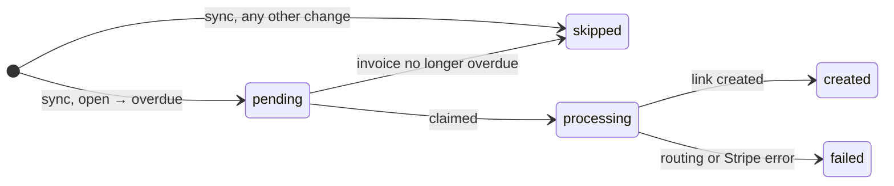

# Payment Status Trigger: Case Study

Detects invoices that just became overdue, creates a mock Stripe payment link routed to the right bank account, and shows the results in a UI.

| Folder | What it is |
| --- | --- |
| `server/` | Backend: Python, FastAPI and SQLite, managed with [uv](https://docs.astral.sh/uv/) |
| `client/` | Frontend: React and TypeScript (Vite) |
| `schema.sql` | Seeded schema, loaded into SQLite when the backend starts |

## How it works

Every time an invoice changes status, a row is added to `payment_status_history`. We look at those rows, not at the invoice itself, to find the moment an invoice went from **open** to **overdue**. For each of those moments, we create one payment link so the customer can pay.

We keep track of our progress in our own table, `payment_link_tracking`. It has one row per history row, so we always know what was already handled.

The work happens in two steps.

### Step 1: Sync (`POST /sync`)

The sync looks for history rows that aren't tracked yet and adds a tracking row for each one:

- `open → overdue` → **pending** (to do)
- anything else (`NULL → open`, `open → paid`, `open → void`, ...) → **skipped**, with the reason saved

History rows that are already tracked are left alone, so running the sync twice adds nothing.

### Step 2: Process (`POST /process`)

The process goes through every **pending** row, one at a time:


1. **Is it still overdue?** If the invoice has been paid or voided since then, the event is out of date. The row becomes **skipped** ("stale event").
2. **Claim it.** The row is switched from `pending` to **processing**, but only if it is still `pending`. If another run got there first, we leave the row alone. This is how one event never gets two payment links.
3. **Find the bank account.** Follow invoice → park → legal entity → bank account in the invoice's currency. We never go via the customer, because one customer can rent at parks owned by different companies. If we find no account or more than one, we stop with a clear error instead of guessing.
4. **Create the payment link** with the Stripe mock. It only logs what it received and returns a fake link. No real Stripe is called.
5. **Save the result.** The row becomes **created** (with the link and bank account) or **failed** (with the error).

If one row fails, the others are still processed.



`POST /run` runs both steps in one call. `POST /reset` empties the tracking table so you can start over.

### With the seed data

The seed has 7 history rows. A first run gives:

| History row | Invoice | Change | Result |
| --- | --- | --- | --- |
| 1 | 1001 | `NULL → open` | skipped |
| 2 | 1001 | `open → paid` | skipped |
| 3 | 1002 | `NULL → open` | skipped |
| 4 | 1002 | `open → overdue` | **created**, paid into bank account 2 (Commerzbank, München Süd) |
| 5 | 1003 | `NULL → open` | skipped |
| 6 | 1004 | `NULL → open` | skipped |
| 7 | 1004 | `open → void` | skipped |

Running again changes nothing and creates no second link. After a reset, the next run gives the same 7 rows again.

## Prerequisites

- [uv](https://docs.astral.sh/uv/getting-started/installation/). It installs the Python version the backend needs (3.14+).
- [Node.js](https://nodejs.org/) 20+ with npm

## Install dependencies

```bash
# Backend: creates server/.venv and installs runtime and dev dependencies
cd server
uv sync

# Frontend
cd ../client
npm install
```

To add a backend dependency, run `uv add <package>` (or `uv add --dev <package>` for dev-only tools) from `server/`.

## Run the project

Start the backend and the frontend in two separate terminals.

### Backend

```bash
cd server
uv run uvicorn main:app --reload
```

- API: http://localhost:8000
- Interactive docs: http://localhost:8000/docs

The database is an in-memory SQLite instance that is rebuilt from `schema.sql` on every start. Restarting the server returns everything to the seeded state.

| Method | Path | Description |
| --- | --- | --- |
| `POST` | `/sync` | Creates one tracking row for each history row that doesn't have one yet (`pending` or `skipped`). Running it again is safe. |
| `POST` | `/process` | Processes every `pending` row: skips it if the invoice is no longer overdue, otherwise claims it, finds the bank account and calls the Stripe mock (`created` or `failed`) |
| `POST` | `/run` | Runs `/sync` and then `/process` in one call |
| `GET` | `/tracking` | Returns all tracking rows |
| `POST` | `/reset` | Deletes all tracking rows so the demo can be rerun. Seeded tables are not touched. |

### Frontend

```bash
cd client
npm run dev
```

The app runs on http://localhost:5173. Other scripts: `npm run build`, `npm run lint`, `npm run preview`.

## Run the tests

```bash
cd server
uv run pytest            # all tests
uv run pytest -v         # one line per test
uv run pytest test/test_sync.py   # a single file
```

The tests live in `server/test/`:

- `test_sync.py`: sync classification, idempotency and reset, run against a fresh seeded database
- `test_sync_endpoints.py`: the `/sync`, `/tracking` and `/reset` endpoints, through FastAPI's test client
- `test_routing.py`: invoice → park → legal entity → bank account routing and its error cases
- `test_stripe_mock.py`: the fake link and the logged inputs
- `test_processing.py`: the acceptance checks, stale events, the claim, and failures handled per row
- `test_processing_endpoints.py`: the `/process` and `/run` endpoints
